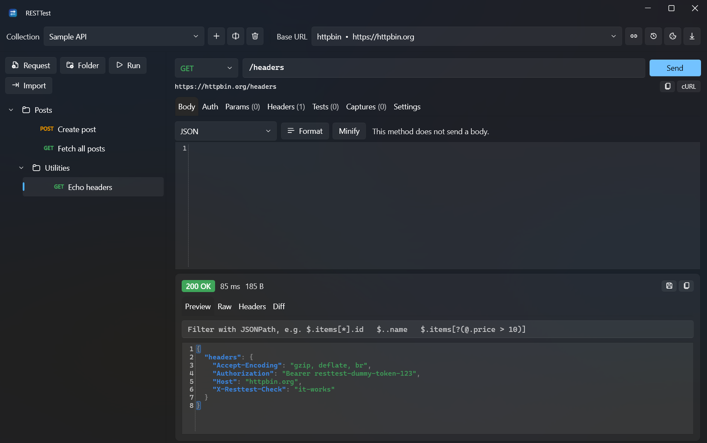

# RESTTest

A lightweight REST client for Windows 10 and 11. No account, no login, no cloud: your collections are plain JSON files on your machine.

**[Download the latest release](https://github.com/lucasriechelmann/RESTTest/releases/latest)** · [Website](https://lucasriechelmann.github.io/RESTTest/)



RESTTest does one thing differently from Postman and Insomnia: **base URLs belong to the collection, not to each request.** A collection holds a list of named base URLs (for example Local, Staging, Production). Pick one in the toolbar and every request in the collection points at it. Requests store only a method and a relative path, so there is nothing to edit per request and no `{{variable}}` syntax to learn.

## Features

- **Collections** with a folder and request tree: inline rename (F2), duplicate, delete, and drag-and-drop reordering.
- **Collection-wide base URLs**, switched from a toolbar combo box. A path that is itself a full `http(s)` URL overrides the base for one-off calls.
- **Request builder**: method, path, query parameters and headers (each row can be toggled off), `:name` path parameters, and a live preview of the resolved URL.
- **Bodies**: JSON (highlighting, bracket matching, Ctrl+F search, Format / Minify), text, XML, URL-encoded forms, and multipart with file uploads.
- **Auth**: bearer token, Basic, or an API key in a header or the query string.
- **Responses**: colour-coded status, time and size, pretty preview with a JSONPath filter, raw body, headers, and Save to disk (byte for byte, for binary bodies too).
- **Tests**: per-request checks on status, response time, headers, JSON paths and body text, evaluated after every send.
- **Collection runner**: run a folder or a whole collection and get a pass/fail report.
- **Request chaining**: capture a value from a response (JSON path, header, status, body) and use it in later requests' fields by name. Runs pass captured values forward.
- **Response diff** against the previous response or a pinned baseline.
- **History** of every send (Ctrl+H), with "Save as request".
- **Cookie jar** that keeps and replays cookies between requests, with a viewer.
- **Import** Postman v2, Insomnia v4, and OpenAPI 3 / Swagger 2 (JSON). **cURL** import and Copy as cURL.
- **Per-request settings**: timeout, follow redirects, verify SSL certificates.
- **Auto-save**, session restore, and the Windows light or dark theme.

### Shortcuts

| Key | Action |
|---|---|
| Ctrl+Enter | Send the request |
| Ctrl+N | New request |
| Ctrl+Shift+N | New folder |
| Ctrl+H | History |
| F2 | Rename the selected item |
| Del | Delete the selected item |

## Install

Download from the [latest release](https://github.com/lucasriechelmann/RESTTest/releases/latest):

- **`RESTTest-<version>-setup-x64.exe`**: installs for your user (no administrator prompt), adds a Start menu entry, upgrades in place, and uninstalls from Settings > Apps.
- **`RESTTest-<version>-portable-x64.zip`**: unzip anywhere and run `RESTTest.exe`.

Both are self-contained (no .NET install needed) and need 64-bit Windows 10 or 11. The installer is not code-signed, so SmartScreen may say "Windows protected your PC": choose **More info**, then **Run anyway**. `SHA256SUMS.txt` in each release lets you verify the download.

## Build and run from source

Requires the [.NET 10 SDK](https://dotnet.microsoft.com/download).

```bash
dotnet build RESTTest.slnx
dotnet run --project RESTTest
dotnet test RESTTest.Tests
```

On first launch the app creates a "Sample API" collection so there is something to send immediately.

## Making a release

Requires [Inno Setup 6](https://jrsoftware.org/isinfo.php) as well.

1. Set `<Version>` in `RESTTest/RESTTest.csproj`.
2. Run `pwsh build/release.ps1`. It runs the tests, publishes a self-contained win-x64 build, and writes the installer, the portable zip and `SHA256SUMS.txt` to `artifacts/<version>/`.
3. Tag `v<version>`, push, and attach the three files to a GitHub release.

The website is the static page in `docs/`, served by GitHub Pages from the `main` branch.

## Where your data lives

Everything is stored under `%APPDATA%\RestTest`:

- `collections\<id>.json`: one human-readable, diffable file per collection (including captured values).
- `history.json`, `cookies.json`, `settings.json`.

Uninstalling leaves these files in place. **Note:** tokens, passwords, API keys and captured values are saved in plain text. Don't share those files if they contain real secrets.

TLS certificate errors are tolerated only for loopback hosts (`localhost`, `127.0.0.1`, `::1`) unless a request turns certificate checking off, so self-signed local dev servers work while remote hosts are validated normally.

## Project layout

| Path | Purpose |
|---|---|
| `RESTTest/` | The WPF app: Models, Services, ViewModels, Views, Behaviors, Controls, Converters |
| `RESTTest.Tests/` | xUnit tests for models, ViewModels, services, the stores and importers |
| `build/` | `release.ps1` and the Inno Setup script `installer.iss` |
| `docs/` | The GitHub Pages website |

Built with .NET 10 and WPF using strict MVVM, with [CommunityToolkit.Mvvm](https://github.com/CommunityToolkit/dotnet), [WPF-UI](https://github.com/lepoco/wpfui) and [AvalonEdit](https://github.com/icsharpcode/AvalonEdit).

For architecture, conventions and a feature-to-code map, see [CLAUDE.md](CLAUDE.md) and `.claude/knowledge/`.

## Not yet supported

YAML import (Insomnia v5, most hand-written OpenAPI), Postman environment files, OAuth, GraphQL editing, binary request bodies, and template variables inside bodies.
